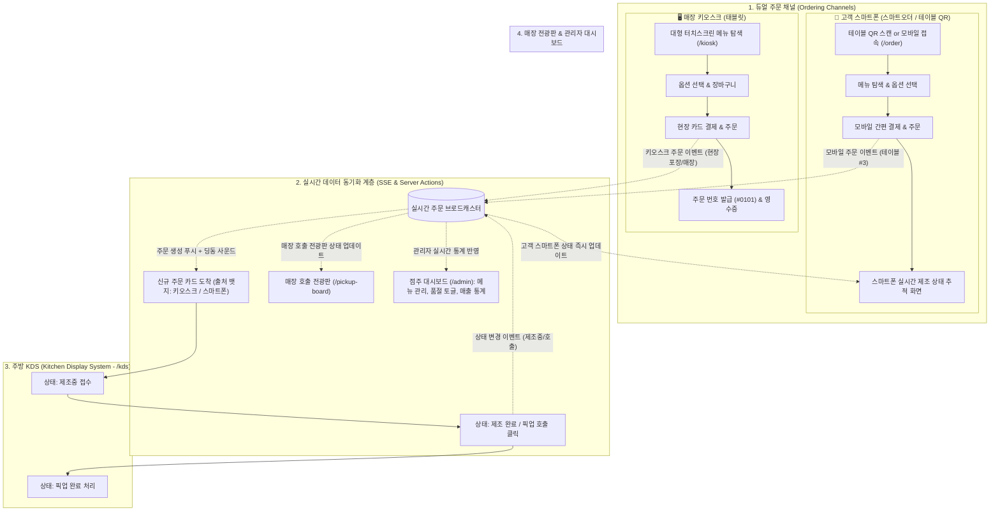
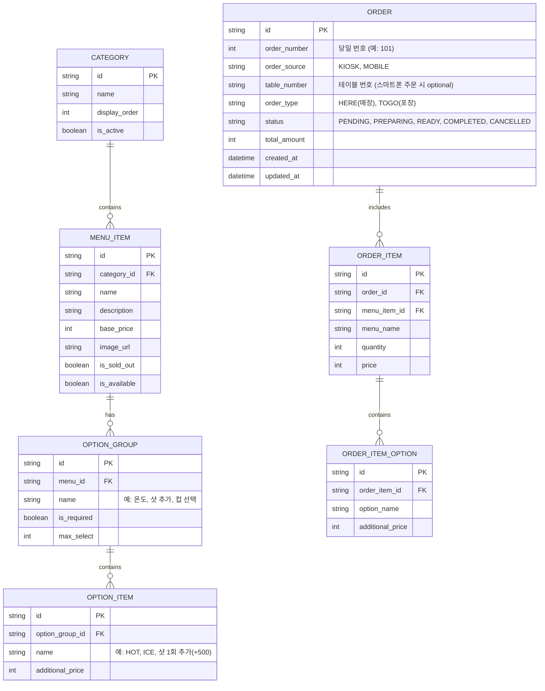

# [PRD] 실시간 카페 운영, 스마트 키오스크 & 모바일 스마트오더 PWA 시스템 (Cafe Flow)

## 1. 프로젝트 개요 (Overview)

### 1.1 프로젝트 명
- **Cafe Flow (가칭)**: PWA 기반 실시간 매장 키오스크, 고객 스마트폰 스마트오더(테이블 QR), 주방 디스플레이(KDS) 및 점주 관리 시스템

### 1.2 배경 및 목적
- 소규모 카페 및 프랜차이즈 매장에서 고가의 전용 POS/키오스크 장비 없이도 태블릿, 스마트폰, PC 등 다양한 디바이스에서 유연하게 운영할 수 있는 통합 웹앱 솔루션
- 고객은 **매장 비치 키오스크(태블릿)**뿐만 아니라 **본인의 개인 스마트폰(모바일 웹/PWA, 테이블 QR)**으로도 줄 서지 않고 직접 메뉴 탐색, 커스텀 옵션 선택, 결제 및 실시간 제조 현황 확인이 가능해야 함
- **키오스크/스마트폰 주문 ➔ 주방 KDS 실시간 접수 및 상태 제어 ➔ 고객 디바이스 실시간 알림 ➔ 점주 대시보드**로 이어지는 유기적인 통합 운영 체계 구축

### 1.3 핵심 가치 (Value Proposition)
1. **스마트폰 스마트오더 & 키오스크 듀얼 주문 채널**:
   - 매장 키오스크 줄이 길거나 자리에 앉았을 때, 고객이 개인 스마트폰으로 QR을 찍거나 웹에 접속해 바로 주문 가능
2. **PWA 기반 멀티 디바이스 지원**:
   - 별도 앱스토어 설치 없이 태블릿(키오스크/주방용), 스마트폰(고객용 모바일 웹/PWA), PC(관리자용)에서 즉시 설치 및 전체화면 구동
3. **실시간 양방향 주문 라이프사이클 동기화**:
   - 고객 주문(키오스크/스마트폰) 발생 즉시 주방 화면에 주문 티켓과 알림음 전송
   - 주방에서 상태를 변경(`제조중` ➔ `제조완료/호출`)하면 고객 스마트폰 및 매장 전광판에 실시간 반영
4. **소상공인 친화적 비용 절감**:
   - 전용 하드웨어 도입 비용 없이 보유 중인 태블릿과 스마트폰만으로 완전한 스마트 카페 운영 가능

---

## 2. 타겟 사용자 및 사용자 페르소나 (Target Users)

| 페르소나 | 주요 사용 디바이스 | 핵심 목표 및 사용 시나리오 |
|---|---|---|
| **스마트폰 주문 고객 (Mobile Customer)** | 개인 스마트폰 (모바일 웹 / PWA) | • 테이블 QR 스캔 또는 모바일 접속 후 자리에서 바로 주문/결제 • 테이크아웃 사전 주문(사이렌오더 형태) • 스마트폰 화면에서 실시간 제조 현황 확인 및 진동/픽업 알림 수령 |
| **키오스크 이용 고객 (Kiosk Customer)** | 매장 비치 태블릿 (키오스크 모드) | • 대형 터치스크린에서 사진과 옵션을 보며 터치로 간편 주문/결제 • 영수증/주문 번호 발급 후 픽업 현황판 및 대기 |
| **주방 바리스타 (Barista / Kitchen)** | 주방 거치형 태블릿 / 모니터 (KDS) | • 실시간 주문 카드 접수(키오스크/스마트폰 출처 및 테이블 번호 식별) • 주문 경과 시간 타이머 확인 및 단계별 상태 변경(접수 ➔ 제조중 ➔ 완료/호출 ➔ 픽업) |
| **매장 점주/관리자 (Admin / Store Manager)** | PC, 태블릿, 모바일 대시보드 | • 메뉴 CRUD, 가격 변경, 품절(Sold-Out) 원클릭 토글 • 실시간 주문 모니터링, 취소/환불 처리 • 당일 채널별(키오스크 vs 스마트폰) 매출 및 판매량 통계 분석 |

---

## 3. 핵심 시스템 아키텍처 및 서비스 흐름 (System Architecture & Flow)

---

## 4. 상세 기능 요구사항 (Functional Requirements)

### 4.1 고객 스마트폰 스마트오더 모드 (`/order`, `/table/[tableNo]`)
- **[P0] 모바일 반응형 원핸드(One-Hand) UX**
  - 스마트폰 세로 화면에 최적화된 하단 고정 장바구니 바(Bottom Sticky Bar)
  - 테이블 QR로 접속 시 테이블 번호 자동 인식 (예: `/table/3` ➔ 주문 시 테이블 #3 자동 기입)
- **[P0] 모바일 메뉴 탐색 & 상세 옵션 선택**
  - 카테고리 가로 스크롤 탭 (커피, 음료, 티, 디저트 등)
  - 하단 바텀 시트(Bottom Sheet) 형태의 옵션 선택 UI (HOT/ICE, 샷 추가, 포장 여부)
- **[P0] 스마트폰 주문 및 간편 결제**
  - 주문 유형 선택 (매장 테이블 이용 / 포장 테이크아웃)
  - 모바일 간이 결제(가상 결제 / 카드 승인 시뮬레이션)
  - 주문 완료 후 곧바로 해당 주문의 실시간 추적 페이지(`/status/[orderId]`)로 자동 이동
- **[P0] 스마트폰 실시간 음료 상태 확인 & 픽업 알림**
  - 실시간 단계 표시: `접수 대기` ➔ `음료 제조 중` ➔ `제조 완료! 픽업해 주세요`
  - "제조 완료" 전환 시 **스마트폰 진동(Navigator Vibrate API) 및 브라우저 알림/사운드** 트리거

### 4.2 매장 비치 키오스크 모드 (`/kiosk`)
- **[P0] 대화면 터치스크린 최적화 (태블릿 가로/세로 지원)**
  - 큼직한 메뉴 카드 썸네일, 고대비 폰트, 넓은 터치 타깃 (최소 64px 이상)
  - 상세 옵션 모달 다이얼로그 (온도, 컵 종류, 샷/시럽 옵션, 수량)
- **[P0] 장바구니 및 현장 결제**
  - 장바구니 사이드 패널 또는 바텀 드로어
  - 주문 번호 발급 (당일 순번 예: #101, #102)
  - "내 스마트폰으로 주문 상태 확인하기" QR코드 표시 (화면의 QR을 스캔하면 스마트폰에서 바로 상태 확인)
- **[P1] 키오스크 대기 모드 (Screen Saver / Attract Screen)**
  - 일정 시간 미사용 시 카페 홍보/시그니처 메뉴 슬라이드 화면 전환

### 4.3 주방 디스플레이 시스템 (Kitchen Display System - `/kds`)
- **[P0] 실시간 주문 카드 뷰 (Grid / Kanban)**
  - 신규 주문 발생 시 실시간 렌더링 및 **딩동 비프(Ding-dong) 오디오 알림**
  - **주문 출처 명확한 시각적 뱃지**:
    - 🔵 `[키오스크 #101 - 매장]`
    - 🟢 `[스마트폰 #102 - 테이블 3번]`
    - 🟠 `[스마트폰 #103 - 포장]`
  - 주문 경과 시간 실시간 타이머 (5분 경과 노란색, 10분 경과 붉은색 경고 하이라이트)
- **[P0] 원클릭 상태 전환 인터랙션**
  - 카드 내 버튼 클릭으로 상태 즉시 갱신 (`접수 대기` ➔ `제조 시작` ➔ `호출/완료` ➔ `픽업`)
- **[P1] 완료 주문 히스토리 & 복원 기능**
  - 실수로 픽업 처리한 주문을 복원하는 서랍(Drawer) 메뉴

### 4.4 매장 호출 전광판 (`/pickup-board`)
- **[P0] 모니터/TV 송출용 픽업 디스플레이**
  - 좌측 영역: **[제조 중인 번호]** (현재 주방에서 준비 중인 주문 번호 목록)
  - 우측 영역: **[준비 완료 / 픽업]** (음료가 나와 고객을 호출하는 주문 번호 - 대형 폰트 & 깜빡임 효과)
  - 새 호출 발생 시 챠임벨 사운드 연동

### 4.5 매장 관리자 대시보드 (`/admin`)
- **[P0] 메뉴 관리 (CRUD & 품절 토글)**
  - 메뉴 추가/수정/삭제 (이름, 카테고리, 기본 가격, 옵션 그룹, 이미지)
  - **원클릭 품절(Sold Out) 토글**: 키오스크 및 고객 스마트폰 화면에 1초 이내 비활성화 반영
- **[P0] 실시간 주문 관리 및 강제 취소**
  - 전체 주문 내역 검색 및 특정 주문 취소/환불
- **[P1] 채널별 매출 분석 통계**
  - 당일 총 매출, 키오스크 vs 스마트폰 주문 비중, 인기 베스트 5 메뉴

---

## 5. 데이터 모델 설계 (Data Schema)

---

## 6. 기술 스택 및 라이브러리 선정 (Tech Stack)

| 영역 | 선정 기술 | 선정 사유 |
|---|---|---|
| **Core Framework** | **Next.js 15 (App Router)** | 풀스택 단일 레포, 고성능 SSR/CSR, Server Actions 내장 |
| **Language** | **TypeScript** | 런타임 주문 데이터 무결성 및 엄격한 타입 안전성 확보 |
| **Styling & UI** | **Tailwind CSS v4 + shadcn/ui + Lucide Icons** | 모바일 및 대화면 태블릿 모두에 완벽 대응하는 반응형 유틸리티 |
| **PWA & 모바일 최적화** | **Web App Manifest + Service Worker** | 모바일 스마트폰 홈 화면 추가, Kiosk 모드 전체화면, 빠른 캐시 |
| **Realtime Sync** | **Server-Sent Events (SSE) / Polling** | 키오스크/스마트폰 주문 ➔ KDS ➔ 고객 화면 1초 이내 초저지연 상태 전파 |
| **State Management**| **Zustand** | 키오스크/모바일 장바구니 및 KDS 실시간 필터 분리 관리 |
| **Database & ORM** | **SQLite (개발) / PostgreSQL + Prisma** | 빠른 로컬 개발 및 안정적인 스키마 마이그레이션 |

---

## 7. 화면 설계 및 라우팅 구조 (Routing Structure)

- `/` : 모드 선택 허브 (스마트폰 주문 / 키오스크 / 주방 KDS / 픽업 전광판 / 관리자 대시보드 바로가기)
- **`/order`** : **고객 스마트폰 전용 모바일 스마트오더 (세로 뷰, 원핸드 UX)**
- **`/table/[tableNo]`** : **테이블 QR 스캔 진입점 (테이블 번호가 자동 부여된 `/order` 화면)**
- `/kiosk` : 매장 비치 태블릿용 대형 터치스크린 키오스크
- `/status/[orderId]` : 고객 개인 스마트폰 실시간 주문 제조 현황 라이브 뷰
- `/kds` : 바리스타 전용 주방 디스플레이 화면 (사운드 알림, 출처별 카드 뷰)
- `/pickup-board` : 매장 디스플레이용 주문 번호 픽업 호출 전광판
- `/admin` : 점주 전용 메뉴 관리 및 실시간 주문/매출 대시보드

---

## 8. 단계별 구현 마일스톤 (Milestones)

### Phase 1: MVP 코어 시스템 (스마트폰 + 키오스크 + KDS 통합)
- [x] PRD 및 Next.js 개발 컨벤션 수립
- [ ] Next.js 15 + Tailwind CSS v4 프로젝트 셋업 및 PWA 매니페스트 구성
- [ ] 데이터베이스 스키마(Order, MenuItem, Option) 및 시드 데이터 구성
- [ ] **고객 스마트폰 스마트오더 UI (`/order`, `/table/[tableNo]`)** 개발
- [ ] **매장 키오스크 UI (`/kiosk`)** 개발
- [ ] **주방 KDS 화면 (`/kds`)** 개발 (키오스크/스마트폰 출처 뱃지 구분, 상태 변경)
- [ ] **실시간 SSE 브로드캐스트** 연동 (주문 생성 시 KDS 알림음, 상태 변경 시 고객 화면/전광판 즉각 갱신)
- [ ] 고객 스마트폰 실시간 상태 추적 페이지 (`/status/[orderId]`)

### Phase 2: 매장 관리자 대시보드 및 전광판
- [ ] 점주 관리자 메뉴 관리 (CRUD 및 원클릭 품절 토글)
- [ ] 매장 호출 전광판 (`/pickup-board`) 화면 구현
- [ ] 주문 취소 및 일별/채널별(키오스크 vs 스마트폰) 매출 통계

### Phase 3: PWA & 오프라인 최적화
- [ ] 스마트폰 PWA "홈 화면에 추가" 안내 배너
- [ ] 스마트폰 픽업 호출 시 브라우저 진동(Vibration API) 및 웹 알림
- [ ] 키오스크 전체화면 모드 잠금
